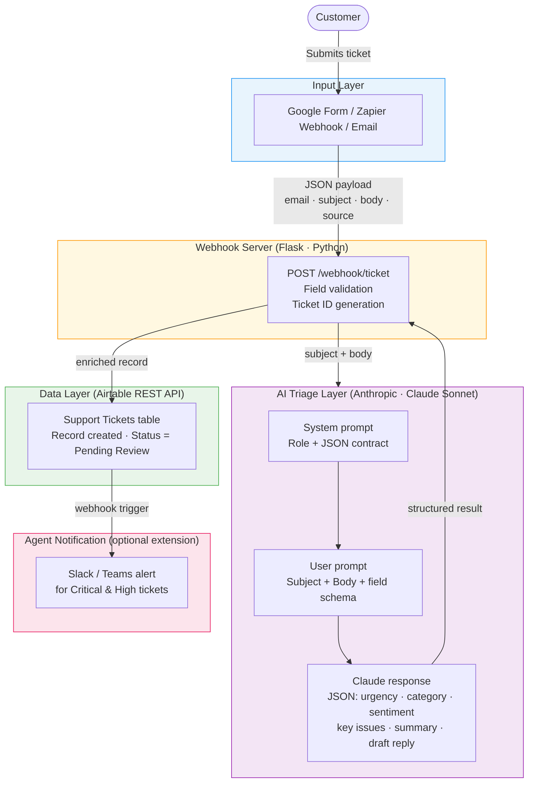

# Architecture — AI-Powered Support Ticket Triage System

## System Flow Diagram



---

## Component Responsibilities

| Component | Technology | Responsibility |
|---|---|---|
| **Input trigger** | Google Form / Zapier / Make / custom form | Captures customer ticket and forwards to webhook |
| **Webhook server** | Python · Flask | Validates payload, assigns ticket ID, orchestrates flow |
| **AI triage engine** | Anthropic Claude Sonnet via Python SDK | Classifies urgency/category/sentiment, extracts issues, drafts reply |
| **Airtable client** | Airtable REST API | Persists enriched ticket record for agent review |
| **Notification (opt.)** | Slack API / Teams webhook | Alerts on-call agent for Critical or High urgency tickets |

---

## Data Flow Detail

```
1. Customer submits form/email
        ↓
2. Zapier / Make triggers POST /webhook/ticket
   {email, subject, body, source}
        ↓
3. Flask validates fields, generates TKT-XXXXXXXX
        ↓
4. Claude API call:
   - System: role + JSON-only contract
   - User: ticket content + field constraints
   → Returns {urgency, category, sentiment, key_issues, summary, suggested_response}
        ↓
5. Airtable REST POST: creates record in "Support Tickets" table
   Status = "Pending Review"
        ↓
6. HTTP 201 response returned to Zapier/Make
   → downstream steps can branch on urgency field
        ↓
7. (Optional) Zapier filter: if urgency = Critical or High
   → Slack message to #support-alerts channel
```

---

## Airtable Table Schema

| Field | Type | Description |
|---|---|---|
| Ticket ID | Single line text | Auto-generated (e.g. TKT-A3F2C1B8) |
| Customer Email | Email | From submission |
| Subject | Single line text | Original subject |
| Body | Long text | Original ticket body |
| Source | Single select | form · email · zapier · webhook |
| Urgency | Single select | Critical · High · Medium · Low |
| Category | Single select | Technical · Billing · Feature Request · Bug Report · General |
| Sentiment | Single select | Positive · Neutral · Negative · Frustrated |
| Key Issues | Long text | Bullet list of extracted problems |
| Summary | Single line text | One-sentence agent-readable summary |
| Suggested Response | Long text | AI-drafted reply ready to send |
| Status | Single select | Pending Review · In Progress · Resolved |
| Received At | Date/time | ISO 8601 UTC timestamp |

---

## Zapier Integration Map

```
Trigger  → Google Form submission (or Typeform / Jotform)
Action 1 → Webhooks by Zapier: POST to /webhook/ticket
Action 2 → Filter: only continue if urgency = Critical or High  (optional branch)
Action 3 → Slack: send message to #support-alerts               (optional branch)
```
