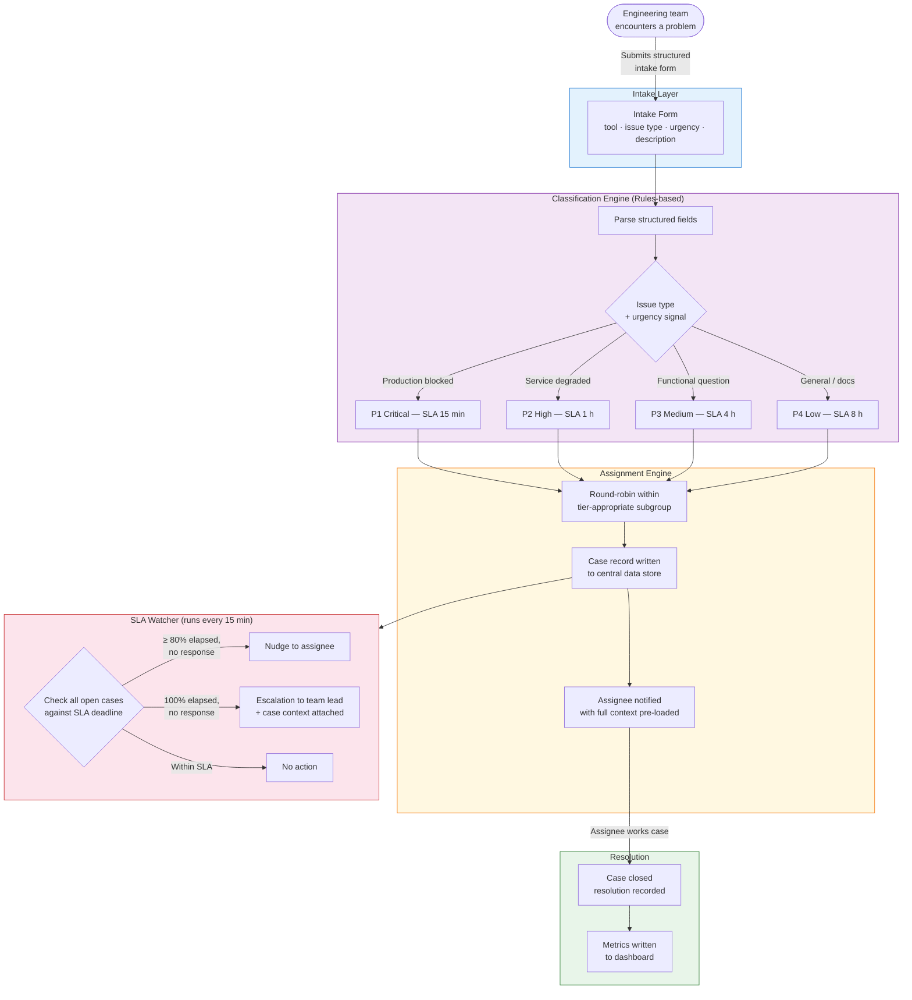

# After-State: Automated Case Routing & Escalation Workflow

---

## Step-by-step breakdown

| Step | Actor | Action | Time cost | Improvement over before |
|---|---|---|---|---|
| 1 | Engineering team | Fills structured intake form | ~2 min | Form enforces required fields; urgency is explicit |
| 2 | Automation | Classifies case into P1–P4 tier | < 1 s | Deterministic; no engineer judgement needed |
| 3 | Automation | Assigns to engineer via round-robin | < 1 s | Race condition eliminated; no reply-all noise |
| 4 | Automation | Writes case record to data store | < 1 s | Data accurate and queryable in real time |
| 5 | Automation | Notifies assignee with full context | < 1 s | Engineer receives a structured brief, not a raw email |
| 6 | Assignee | Works the case | Varies | No inbox scanning; no spreadsheet update required |
| 7 | SLA Watcher | Checks open cases every 15 min | Automated | Proactive nudge before breach; escalation at breach |
| 8 | Assignee | Closes case — automation records resolution | < 1 s | Metrics captured automatically; no manual update |

**Total human overhead per case (triage + tracking): ~2 min**
**Team overhead per week (~110 cases): ~3–4 engineer-hours (vs. 27–37 before)**

---

## Key Differences at a Glance

| Dimension | Before | After |
|---|---|---|
| Intake | Free-form email | Structured form with required fields |
| Classification | Manual, informal, inconsistent | Rules-based, deterministic, auditable |
| Assignment | Self-assign race condition | Round-robin, collision-free |
| SLA visibility | None | Real-time dashboard + proactive alerts |
| Escalation | Reactive, by memory | Automatic at 80% and 100% of SLA |
| Data quality | ~60% spreadsheet accuracy | ~99% automated record accuracy |
| Engineer triage overhead | ~4.5 h/week | ~0.4 h/week |
