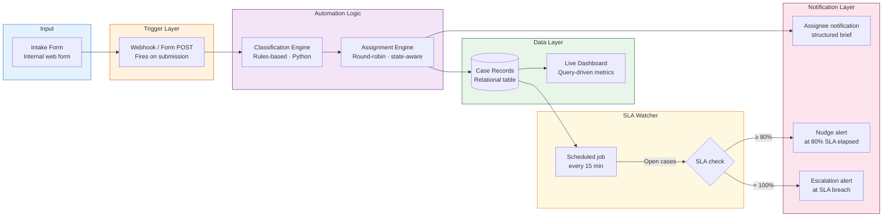

# Technical Architecture — Automated Case Routing System

## System Overview



---

## Component Detail

### Intake Form
- Internal web form with required fields: requester name, team, tool name, issue type (dropdown), urgency self-assessment (radio), free-text description
- On submit, posts a JSON payload to the webhook endpoint
- Form validation enforces completeness before submission is allowed

### Webhook Trigger
- Lightweight HTTP endpoint that receives the form POST
- Validates payload schema and rejects malformed submissions with a 400 response
- Passes validated payload to the classification engine

### Classification Engine
Rules engine implemented in Python. Decision logic:

```
if issue_type == "production_blocked":
    tier = P1, sla_minutes = 15
elif issue_type in ("service_degraded", "critical_defect"):
    tier = P2, sla_minutes = 60
elif issue_type in ("functional_question", "defect", "integration_issue"):
    tier = P3, sla_minutes = 240
else:  # general_question, documentation, feature_request
    tier = P4, sla_minutes = 480
```

The user-supplied urgency signal is used as a modifier: if the requester self-assessed as "Critical" but the issue type maps to P3, the tier is promoted to P2 and flagged for human review.

### Assignment Engine
- Maintains a per-tier assignment queue (ordered list of eligible engineers)
- Pops the next engineer from the front of the relevant queue and appends them to the back (round-robin)
- Checks engineer availability flag before assignment; skips engineers marked as out-of-office
- Writes the assignee to the case record atomically to prevent double assignment

### Case Records (Data Layer)
Relational table with the following schema:

| Column | Type | Description |
|---|---|---|
| case_id | VARCHAR | Auto-generated (e.g. CASE-2024-00471) |
| requester_email | VARCHAR | From form |
| team | VARCHAR | From form |
| tool_name | VARCHAR | From form |
| issue_type | VARCHAR | From form dropdown |
| urgency_self_assessed | VARCHAR | From form radio |
| description | TEXT | From form |
| tier | VARCHAR | P1 / P2 / P3 / P4 (from classification engine) |
| sla_deadline | TIMESTAMP | Calculated at intake |
| assignee | VARCHAR | From assignment engine |
| status | VARCHAR | Open / In Progress / Resolved / Escalated |
| first_response_at | TIMESTAMP | Set on first reply to requester |
| resolved_at | TIMESTAMP | Set on case close |
| created_at | TIMESTAMP | Set at intake |

### SLA Watcher
- Scheduled job that polls the data store every 15 minutes
- Query: `SELECT * FROM cases WHERE status NOT IN ('Resolved') AND sla_deadline IS NOT NULL`
- For each open case, calculates `elapsed_pct = (now - created_at) / (sla_deadline - created_at)`
- Sends nudge notification if `elapsed_pct >= 0.80` and no first-response recorded
- Sends escalation notification if `elapsed_pct >= 1.00` and case not resolved
- Idempotent: tracks `nudge_sent` and `escalation_sent` boolean flags to avoid duplicate alerts

### Live Dashboard
- Reads directly from the case records table
- Key metrics displayed: queue depth by tier, SLA health (% within SLA), category distribution, mean time to assignment, mean time to resolution
- Refreshed on a 5-minute polling interval

---

## Data Flow Summary

```
Form submission (requester)
    → Webhook validates payload
    → Classification engine assigns tier + SLA deadline
    → Assignment engine assigns engineer (collision-free)
    → Case record created in DB
    → Assignee notification sent
    → (Background) SLA Watcher polls every 15 min
        → Nudge if 80% elapsed
        → Escalation to team lead if 100% elapsed
    → Assignee resolves and closes case
    → resolved_at recorded; dashboard updates
```
