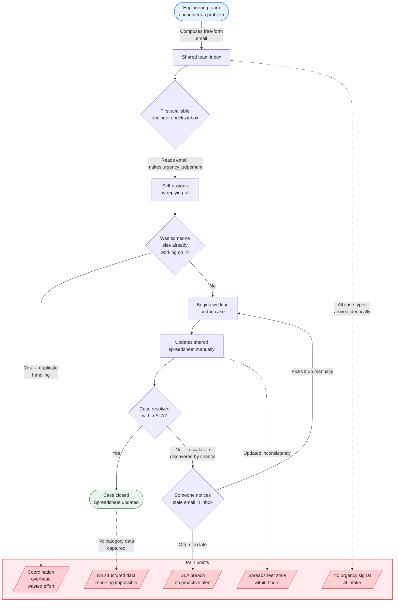

# Before-State: Manual Case Handling Process

---

## Step-by-step breakdown

| Step | Actor | Action | Time cost | Problem |
|---|---|---|---|---|
| 1 | Engineering team | Writes free-form email to shared alias | — | No structure; urgency invisible |
| 2 | All engineers | Monitor shared inbox | Passive background attention | Distracting; no signal-to-noise filtering |
| 3 | First available | Reads email, judges urgency informally | ~5 min per case | Inconsistent — same case rated differently by different engineers |
| 4 | First available | Replies-all to claim the case | ~2 min | Race condition — two engineers often start simultaneously |
| 5 | Assignee | Works the case | Varies | No context pre-loaded; must re-read full email chain |
| 6 | Assignee | Updates spreadsheet | ~3 min | Manual; frequently skipped under pressure |
| 7 | Anyone | Notices old unresolved email | Reactive | SLA breach discovered after the fact, not before |
| 8 | Assignee or team lead | Escalates informally | ~5 min | No consistent escalation path |

**Total overhead per case (triage + tracking): ~15–20 min**
**Team overhead per week (~110 cases): ~27–37 engineer-hours**
