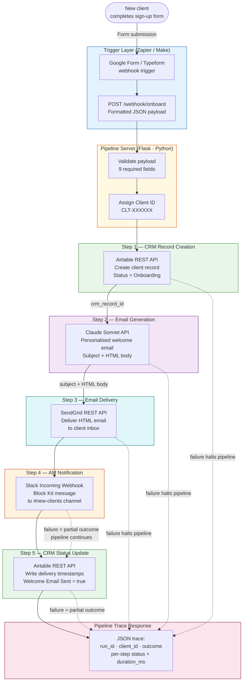
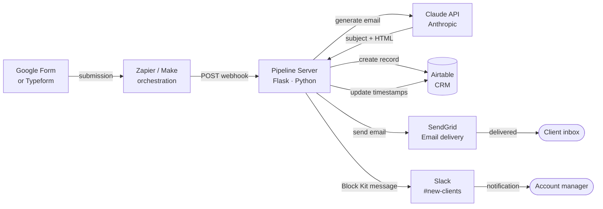

# Workflow Diagram — Automated Client Onboarding Pipeline

## End-to-End System Flow



---

## System Connections Map



---

## Pipeline Step Detail

| Step | System | Critical | On failure |
|---|---|---|---|
| 1. CRM record creation | Airtable | Yes | Pipeline halts; 502 returned |
| 2. Email generation | Claude API | Yes | Pipeline halts; 502 returned |
| 3. Email delivery | SendGrid | Yes | Pipeline halts; 502 returned |
| 4. AM notification | Slack | No | Logged; outcome = "partial"; pipeline continues |
| 5. CRM status update | Airtable | No | Logged; outcome = "partial" |

---

## Pipeline Trace Response (sample)

```json
{
  "run_id": "RUN-4A3B2C1D",
  "client_id": "CLT-F7E6D5",
  "started_at": "2024-11-14T09:32:01.441Z",
  "completed_at": "2024-11-14T09:32:03.887Z",
  "total_duration_ms": 2446,
  "outcome": "success",
  "steps": [
    { "step": "crm_create",      "status": "success", "at": "2024-11-14T09:32:01.443Z", "duration_ms": 341, "crm_record_id": "recXXXXXXXXXXXXXX" },
    { "step": "email_generate",  "status": "success", "at": "2024-11-14T09:32:01.785Z", "duration_ms": 1204, "subject": "Fewer exception calls, more deliveries on time — let's get started" },
    { "step": "email_send",      "status": "success", "at": "2024-11-14T09:32:02.990Z", "duration_ms": 287, "message_id": "d3b07384d113edec49eaa6238ad5ff00" },
    { "step": "slack_notify",    "status": "success", "at": "2024-11-14T09:32:03.278Z", "duration_ms": 412 },
    { "step": "crm_update",      "status": "success", "at": "2024-11-14T09:32:03.691Z", "duration_ms": 196 }
  ]
}
```

---

## Zapier Scenario Map

| Step | Module | Configuration |
|---|---|---|
| Trigger | Google Forms — New Response | Watch the onboarding sign-up form |
| Action 1 | Webhooks by Zapier — POST | `https://your-server/webhook/onboard` with all form fields mapped to JSON |
| Action 2 | Filter — Only continue if | `outcome` = "success" or "partial" (skip on 502) |
| Action 3 (optional) | Delay — Wait | 24 hours |
| Action 4 (optional) | Slack — Send message | Reminder to AM: "Have you reached out to {{company_name}} yet?" |

For Make (Integromat): use the HTTP module for the webhook POST; the trace JSON response
maps directly into downstream modules via the `steps[*].status` path.
