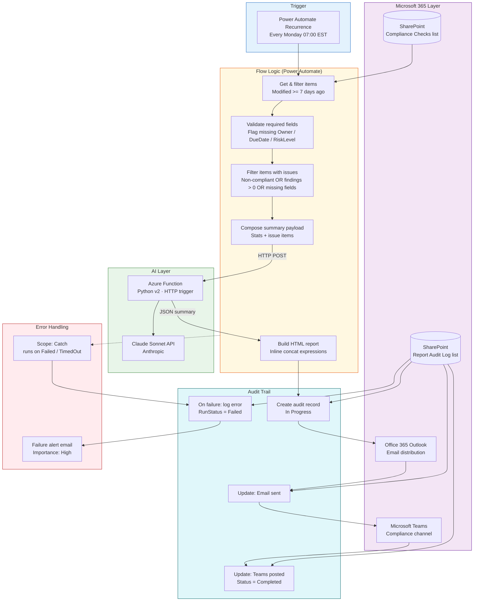

# Architecture — Automated Compliance Reporting Workflow

## End-to-End System Flow



---

## Component Map

| Component | Platform | Role |
|---|---|---|
| Recurrence trigger | Power Automate | Fires every Monday at 07:00 EST |
| Compliance Checks | SharePoint List | Source of weekly compliance check data |
| Report Audit Log | SharePoint List | Immutable run history — every execution logged |
| Power Automate flow | Power Automate Premium | Orchestrates all steps; data filtering; HTML composition |
| Azure Function | Azure Functions (Python) | Stateless HTTP endpoint; calls Claude API; returns structured JSON |
| Claude Sonnet | Anthropic API | Generates executive summary, risk assessment, findings, actions |
| Office 365 Outlook | M365 | Delivers HTML report to distribution list |
| Microsoft Teams | M365 | Posts condensed summary card to compliance channel |

---

## Data Flow

```
1. Monday 07:00 — recurrence fires
        ↓
2. SharePoint: GET compliance checks modified in last 7 days (up to 500)
        ↓
3. Filter: exclude Archived items
        ↓
4. Select: map fields + compute MissingFields for each item
        ↓
5. Filter: keep items where Status != Compliant OR FindingCount > 0 OR MissingFields != ""
        ↓
6. Compose payload: { report_title, period, total, issues, compliant, items[] }
        ↓
7. HTTP POST → Azure Function → Claude API
   Response: { executive_summary, key_findings, risk_assessment,
               recommended_actions, trend_note }
        ↓
8. Compose HTML: inline concat with AI sections embedded
        ↓
9. SharePoint: create audit record (RunStatus = "In Progress")
        ↓
10. Outlook: send HTML email to distribution list
        ↓
11. SharePoint: patch audit record → EmailSent = true
        ↓
12. Teams: post summary card to compliance channel
        ↓
13. SharePoint: patch audit record → TeamsPostSent = true, RunStatus = "Completed"

        [On any failure above]
        ↓
E1. Scope Catch triggers
E2. SharePoint: create [FAILED] audit record with error details
E3. Outlook: send high-importance failure alert to distribution list
```

---

## Security Architecture

```
Power Automate flow
    │
    ├── SharePoint: OAuth via service account connection
    ├── Outlook: OAuth via service account connection
    ├── Teams: OAuth via service account connection
    │
    └── Azure Function: x-functions-key header
            │
            └── ANTHROPIC_API_KEY stored as Azure Function App Setting
                (encrypted at rest, never exposed to Power Automate)
```

**The Anthropic API key never leaves the Azure Function.** Power Automate only holds the function-level key, which can be rotated without touching the flow definition.

---

## Azure Function Architecture

```
Power Automate HTTP action
    → POST /api/generate-summary
    → Header: x-functions-key: {AISummaryFunctionKey}
    → Body: { report_title, report_period, total_checks,
              items_with_issues, compliant_count, items[] }

Azure Function (Python v2)
    → Validates payload
    → Formats items[] as structured text (max 30 items to cap tokens)
    → Calls Claude Sonnet with system + user prompt
    → Parses JSON response
    → Returns: { executive_summary, key_findings, risk_assessment,
                 recommended_actions, trend_note }

Power Automate (Parse JSON action)
    → Maps response fields into HTML report and Teams card
```
