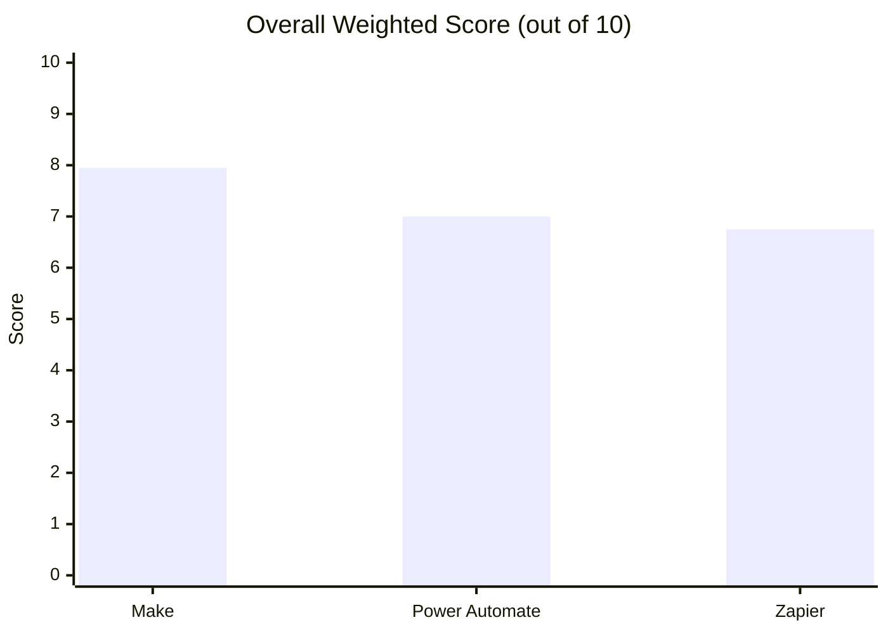
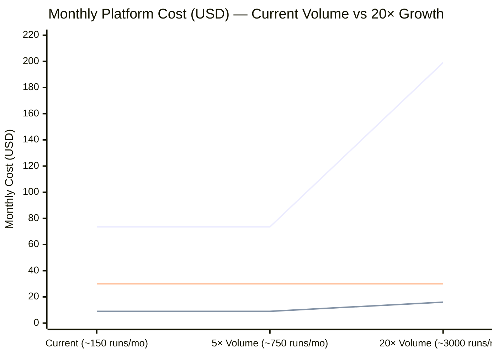
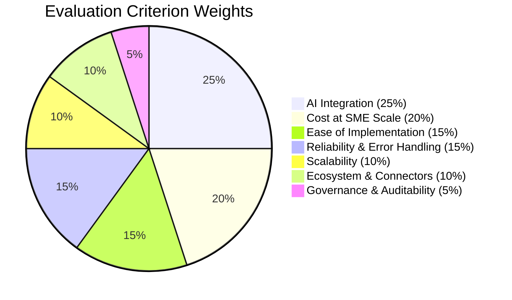
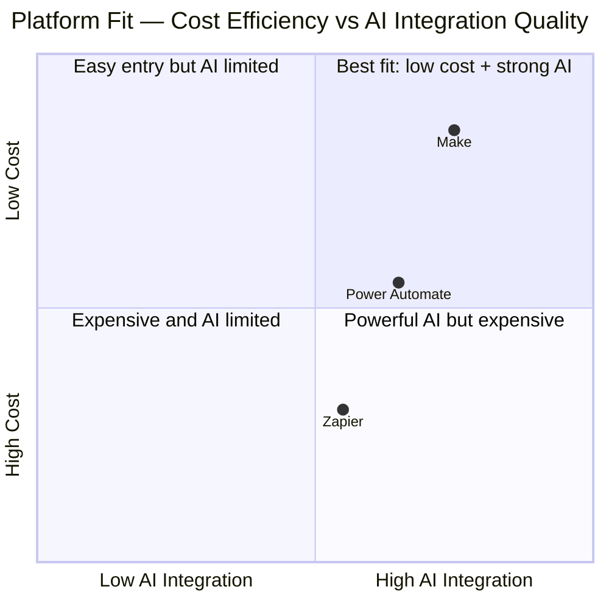
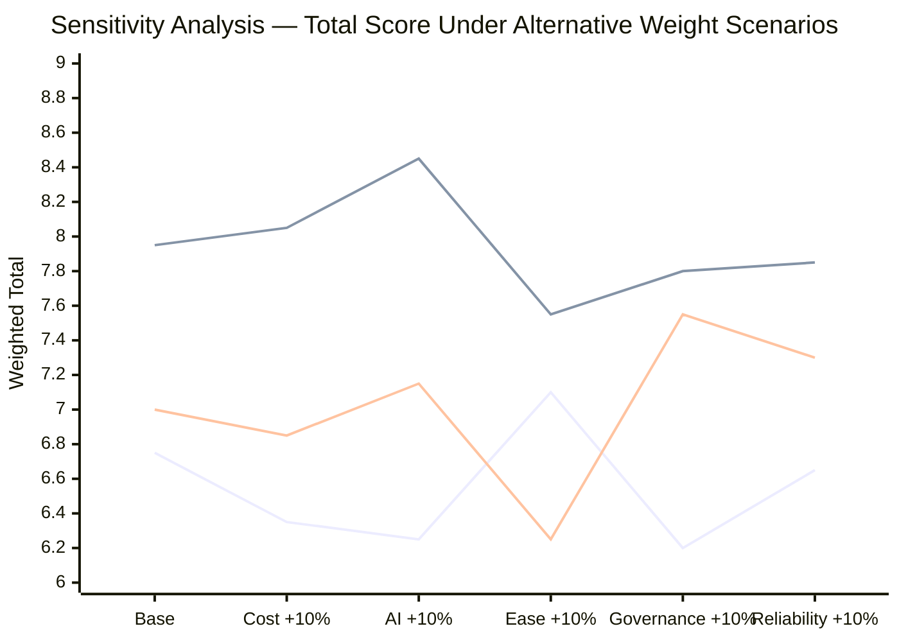
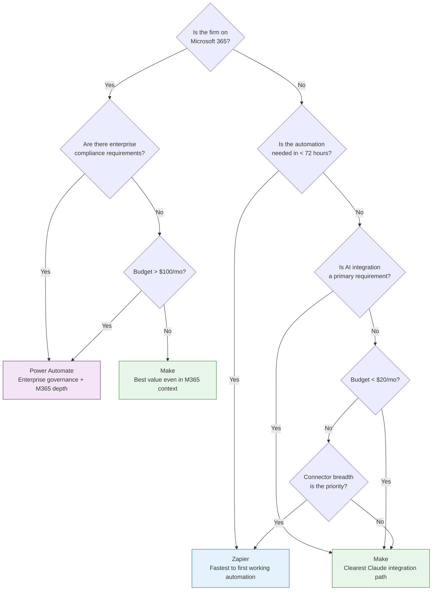

# Visual Comparisons

## Overall Weighted Scores

---

## Score by Criterion

```mermaid
xychart-beta
    title "Raw Scores by Criterion — Zapier vs Make vs Power Automate"
    x-axis ["Cost", "Ease", "AI Integration", "Reliability", "Scalability", "Ecosystem", "Governance"]
    y-axis "Score (1-10)" 0 --> 10
    bar [5, 9, 6, 7, 6, 10, 5]
    bar [9, 7, 8, 8, 8, 8, 6]
    bar [6, 4, 7, 9, 9, 7, 9]
```

*Bars left-to-right: Zapier · Make · Power Automate*

---

## Monthly Cost Comparison

*Lines top-to-bottom at 20× volume: Zapier · Power Automate · Make*

---

## Criterion Weight Distribution

---

## Platform Fit for This Scenario

---

## Sensitivity Analysis — Does the Winner Change?

*Lines: Zapier · Make · Power Automate*

**Make leads in every scenario tested.** The recommendation is robust to reasonable weight changes.

---

## Decision Tree — Platform Selection

